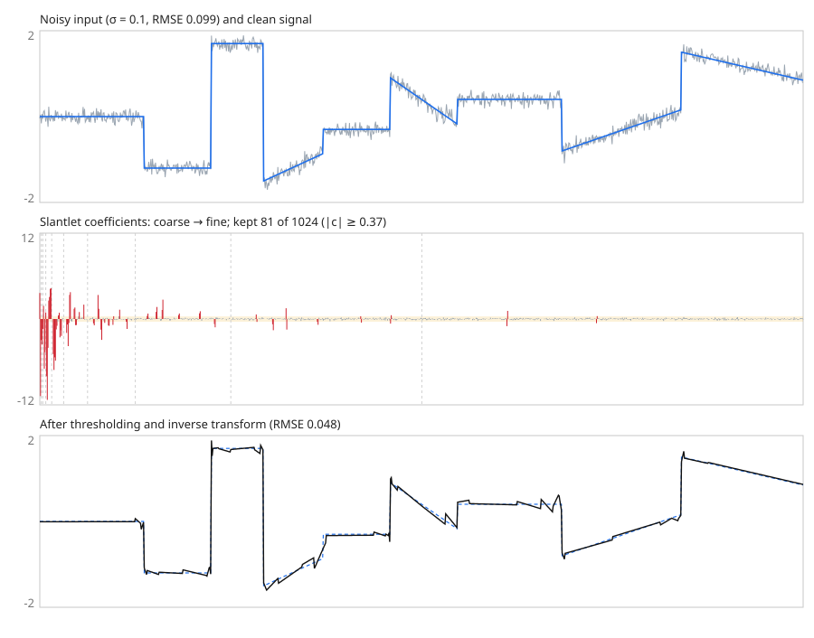
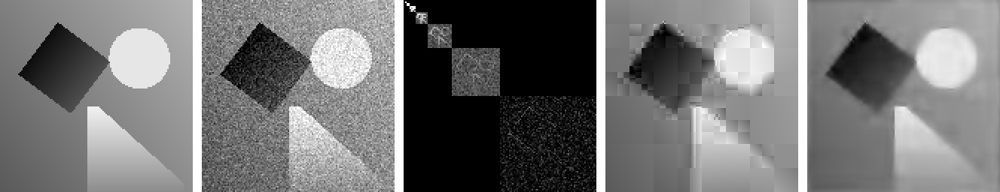

# slantlet

[](https://github.com/sunsided/slantlet/actions/workflows/ci.yml)
[](https://crates.io/crates/slantlet)
[](https://docs.rs/slantlet)

The Slantlet transform (Selesnick, 1999) in Rust: an orthogonal discrete
wavelet-like transform. Its basis functions are piecewise linear, have two
vanishing moments, and have shorter support than the Daubechies-2 wavelet.

- Forward and inverse transforms work in place in `O(N)`, for any power-of-two length.
- `forward_frames` / `inverse_frames` handle any length (or a stream) frame by
  frame, losslessly and without padding.
- 2-D: separable (`forward_2d`, any size via `forward_2d_frames`) and a
  non-separable, plane-annihilating variant (`forward_2d_planar`) following
  the paper's outline (Sec. II-L); its exact detail basis is this crate's own
  choice, as the paper never published one.
- The basis is orthonormal, so energy is preserved and `inverse` is the transpose of `forward`.
- Linear signals (`a + b·n`) produce zero detail coefficients.
- Coefficients match the paper's slantlet matrix (Sec. II-F, Fig. 5) exactly.
- O(N) and cache-blocked: 0.6–1.1 billion samples/s on one laptop CPU core;
  see [BENCH.md](BENCH.md) for numbers and the hardware they were measured on.
- Optional features:
  - `rayon` parallelises large transforms (frames, single transforms from
    2¹⁹ samples, separable 2-D, and planar 2-D from 512×512), with
    bit-identical results.
  - `wgpu` runs frame-wise transforms as a WGSL compute shader (`f32`, frames
    up to 4096 samples), for host data or for buffers already on the GPU
    (`slantlet::gpu`). It needs Rust 1.87.
- No dependencies by default.

```rust
let mut x = [1.0, 4.0, -2.0, 0.5, 3.0, 3.0, 0.0, -1.0];
slantlet::forward(&mut x)?;   // x = [h, f, g₂, Jg₂, g₁, Jg₁, g₁, Jg₁]
slantlet::inverse(&mut x)?;   // back to the signal
# Ok::<(), slantlet::Error>(())
```

See the crate docs for the basis definition and coefficient layout.

## How it works

Every slantlet basis function is piecewise linear on the two halves of an
aligned block. So a block's contribution is fully described by two numbers:
its projections onto a unit constant (`c`) and a unit ramp (`d`). The
transform builds these bottom-up:

1. **Pairs.** Each pair of samples becomes `(c, d)`.
2. **Merges.** Two neighbouring blocks `(c_L, d_L)`, `(c_R, d_R)` combine,
   through a fixed 4×4 orthogonal map, into the parent's `(c, d)` and the
   block's two slantlet coefficients `g` and `Jg`. Repeating this up to the
   whole signal leaves `h` and `f` at the top.

Each sample takes part in a constant number of operations, so the cost is
O(N). The inverse runs the same merges backwards.

### Cache blocking

The merge at one level only reads blocks that lie inside one aligned
block of the next level. So every level that fits inside, say, 2048 samples
can run on that chunk alone. A naive level-by-level loop instead makes a full
pass over the signal for every level, which is slow once the signal no longer
fits in cache. The transform therefore works in three phases:

1. **Stream** the samples once into the `(c, d)` pair arrays. This consumes
   the input, so detail coefficients can then be written anywhere in the
   output without overwriting unread samples.
2. **Blocked levels.** For each chunk of 1024 pairs, which fits in L1/L2, run
   all ten levels that fit inside it. Each level reads from one buffer and
   writes to another, alternating between the chunk and a small temp buffer.
   Source and destination never overlap, so the compiler can vectorise the
   loop. The chunk's final `(c, d)` goes into slot `k`, which lies in an
   already consumed chunk.
3. **Coarse levels.** Merge the remaining `N / 2048` slots level by level in
   place; this costs little.

The inverse mirrors this. It expands the coarse levels first, then each
chunk in descending order, so no chunk is overwritten before it is read.
Every block size gives bit-identical output (a test checks all of them),
so blocking is purely a speed-up. Compared with the level-by-level loop it
gains 20–50 % (see [BENCH.md](BENCH.md)).

`forward_frames` is fast for the same reason: each frame stays in cache.

## Denoising example

[`examples/denoise.rs`](examples/denoise.rs) runs the experiment of the
paper's Fig. 6:
1. add white noise to a piecewise-linear signal;
2. transform it;
3. zero every detail coefficient below the universal threshold σ·√(2 ln N);
4. transform back.

Slantlet details cancel ramps exactly, so the clean signal needs only a few
coefficients. Because the transform is orthonormal, the noise keeps the same
σ in every coefficient, and the threshold removes most of it.



1-D, 1024 samples, σ = 0.1. 81 of 1024 coefficients survive (red, top to
bottom: coarse to fine scales, dashed lines between scales), and the error
halves (RMSE 0.099 → 0.048).



2-D, 128×128, σ = 0.08, using the planar transform, whose details cancel
planes. From left to right:

1. the piecewise-planar test image;
2. the noisy image (RMSE 0.080);
3. detail energy per block on a log scale, arranged coarse (top left) to
   finest (bottom right). Only edges stand out from the noise.
4. hard thresholding (204 of 16384 coefficients kept, RMSE 0.042), with the
   block artifacts typical of a non-redundant transform;
5. cycle spinning (Coifman & Donoho): denoise all 8×8 shifts and average
   them, RMSE 0.033.

```sh
cargo run --release --example denoise   # rewrites docs/denoise-*.{svg,png}
```

## Applications

Short, piecewise-linear basis functions localize transients well, which makes
slantlet subband energies useful features for vibration-based fault
diagnosis. Alobaidy et al. ([*Sci. Rep.* 15, 34145, 2025][robot]) use them with
a small neural network to detect joint faults in an industrial robot arm
from tip-accelerometer data.

[`examples/fault_features.rs`](examples/fault_features.rs) shows that
feature-extraction step on synthetic data. It uses the paper's recording
length (3973 samples), splits each recording into power-of-two frames, and
reports the relative energy per scale; gear-like impacts raise the
finest-scale share by more than an order of magnitude:

```sh
cargo run --example fault_features
```

[robot]: https://doi.org/10.1038/s41598-025-09272-9

## Testing

With [go-task](https://taskfile.dev):

```sh
task test        # unit, property, reference-matrix and doc tests
task fuzz:smoke  # 10 s per fuzz target (nightly + cargo-fuzz)
task ci          # fmt check, clippy, docs, tests, fuzz smoke run
```

`tests/reference.rs` builds the slantlet matrix from the paper's closed-form
filters and checks that `forward` reproduces it entry by entry. Golden values in
`tests/golden/` pin both the crate and that reference.

## Reference

I. W. Selesnick, "The Slantlet Transform", *IEEE Transactions on Signal
Processing*, 47(5):1304–1313, 1999.

## License

Licensed under the [European Union Public Licence v. 1.2](LICENSE) (EUPL-1.2).
